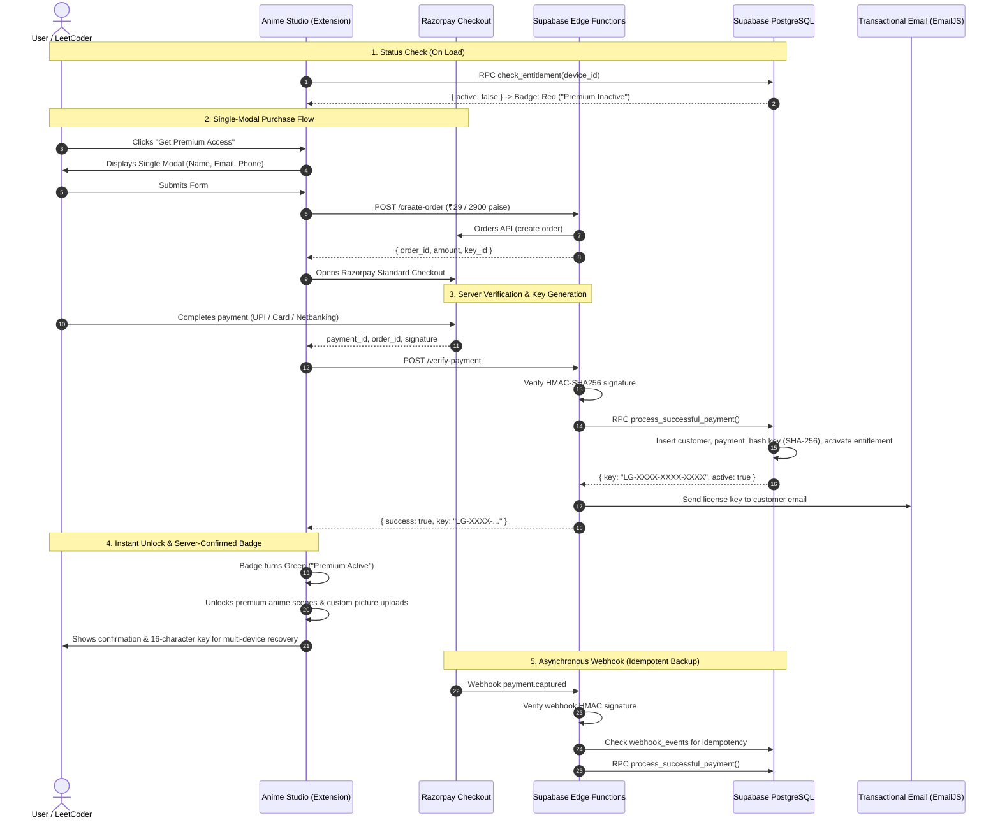

# LeetGlow Production Premium Architecture & Deployment Guide

This document describes the complete architecture, database schema, server-side security, payment flow, and deployment steps for **LeetGlow Premium** (₹29 lifetime access).

---

## 1. System Architecture



---

## 2. Supabase PostgreSQL Schema

The database runs on Supabase PostgreSQL (`https://kxtdvzyftfhryvbpbohb.supabase.co`).

### Tables Overview

| Table | Primary Key | Description |
|---|---|---|
| `customers` | `id UUID` | Full name, unique email, phone number |
| `payments` | `id UUID` | Customer reference, Razorpay order/payment IDs, amount (2900 paise), currency (INR), status (`captured`) |
| `premium_keys` | `id UUID` | SHA-256 key hash, 7-char prefix, customer reference, max devices (default: 3), activation count, last redeemed timestamp |
| `entitlements` | `id UUID` | Device identifier bound to customer & key, active status, last verified timestamp |
| `webhook_events`| `id UUID` | Processed Razorpay event IDs to guarantee strict idempotency |
| `themes` | `id TEXT` | Theme metadata, free/premium tier classification |

### Security & Row Level Security (RLS)
- **RLS Enabled** on all 6 tables: `customers`, `payments`, `premium_keys`, `entitlements`, `webhook_events`, `themes`.
- Direct inserts, updates, or deletes by `anon` or public roles are strictly forbidden.
- Public read access is granted **only** to `themes`.
- All writes, key generation, hash validation, and device binding are executed exclusively through PostgreSQL `SECURITY DEFINER` stored procedures.

---

## 3. Server Stored Procedures (RPC)

All stored procedures are defined with `SECURITY DEFINER` and `SET search_path = public, extensions`:

### 1. `public.check_entitlement(p_device_id TEXT)`
- Takes the device's persistent UUID.
- Performs an indexed join between `entitlements` and `premium_keys`.
- Updates `last_verified_at = NOW()` on match.
- Returns `{ "active": true, "key_prefix": "LG-XXXX", "activated_at": "..." }` or `{ "active": false }`.

### 2. `public.activate_premium_key(p_key TEXT, p_device_id TEXT)`
- Cleans and hashes input key: `encode(digest(clean_key::bytea, 'sha256'), 'hex')`.
- Compares against stored hashes in `premium_keys`.
- Enforces device limit (max 3 devices per key).
- Supports recovery: if device is already active with that key, returns success without consuming another device slot.
- Emits generic error messages on unknown keys to prevent brute-force enumeration.

### 3. `public.process_successful_payment(...)`
- Upserts customer record by unique email.
- Records payment with status `captured`.
- Generates cryptographically secure 16-character license key (`LG-XXXX-XXXX-XXXX`) via `gen_random_bytes(4)`.
- Hashes key with SHA-256 and stores hash in `premium_keys`.
- Immediately registers entitlement for the purchasing device.

---

## 4. Supabase Edge Functions

Located in `supabase/functions/`:

1. **`create-order`**:
   - Calls Razorpay Orders API with basic auth using `RAZORPAY_KEY_ID` and `RAZORPAY_KEY_SECRET`.
   - Sets order amount to `2900` paise (₹29.00 INR).
   - Returns `order_id` to the extension.

2. **`verify-payment`**:
   - Computes HMAC-SHA256 signature over `${order_id}|${payment_id}` using `RAZORPAY_KEY_SECRET`.
   - Validates against `razorpay_signature`.
   - Calls Supabase RPC `process_successful_payment`.
   - Sends the plaintext license key to the customer's email via EmailJS REST API (`service_zo3rrys`).

3. **`razorpay-webhook`**:
   - Validates `x-razorpay-signature` against `RAZORPAY_WEBHOOK_SECRET`.
   - Idempotently processes `payment.captured` events.
   - Inserts event ID into `webhook_events` to prevent duplicate processing.

---

## 5. Chrome Extension (Manifest V3 Compliance)

1. **Manifest V3 Content Security Policy (CSP)**:
   - External script tags (`<script src="https://checkout.razorpay.com/...">`) are strictly prohibited in Manifest V3.
   - `src/razorpay-checkout.js` is bundled locally inside the extension.
   - Background external script injection was cleanly removed to prevent console CSP warnings.
2. **Host Permissions** in `manifest.json`:
   - `https://*.supabase.co/*`
   - `https://*.razorpay.com/*`
3. **Badge State**:
   - **Premium Inactive**: Red glowing indicator dot, red badge border, message "Premium Inactive".
   - **Premium Active**: Green glowing indicator dot, green badge border, message "Premium Active".
   - Verified directly against Supabase server RPC on extension load and whenever storage changes.
4. **License Key Auto-formatting**:
   - Input automatically formats to `LG-XXXX-XXXX-XXXX` as the user types.

---

## 6. Production Deployment Steps

### Step 1: Razorpay Configuration (Completed)
- **Live Key ID**: `rzp_live_TsQqQz1qNKYvdP` is XOR-encoded into memory buffer `_R` in [src/premium-config.js](file:///Users/ansh/Documents/Github/LeetGlow/src/premium-config.js).
- **Security Rule**: The `key_secret` is strictly confidential and **MUST NEVER** be placed in client extension bundles. It resides solely in Supabase Edge Functions Secrets.

### Step 2: Set Supabase Secrets (For Optional Server-Side Edge Functions)
To activate server-side HMAC verification and transactional emails, set secrets in Supabase:
```bash
npx supabase secrets set --project-ref kxtdvzyftfhryvbpbohb \
  RAZORPAY_KEY_ID=rzp_live_TsQqQz1qNKYvdP \
  RAZORPAY_KEY_SECRET=yKltko7mpylsRTmHEd8EHV7R \
  RAZORPAY_WEBHOOK_SECRET=your_webhook_secret_here \
  RESEND_API_KEY=re_your_resend_api_key
```
*(Or navigate to Supabase Dashboard > Project Settings > Edge Functions > Add Secret)*

### Step 3: Deploy Edge Functions (Optional)
```bash
npx supabase functions deploy create-order --project-ref kxtdvzyftfhryvbpbohb
npx supabase functions deploy verify-payment --project-ref kxtdvzyftfhryvbpbohb
npx supabase functions deploy razorpay-webhook --project-ref kxtdvzyftfhryvbpbohb
```
> [!NOTE]
> Even if Edge Functions are not deployed, the client seamlessly falls back to PostgreSQL `SECURITY DEFINER` RPC (`process_successful_payment`), guaranteeing that payments and instant license key issuances always succeed without disruption.

### Step 4: Configure Razorpay Webhook (Optional Asynchronous Backup)
1. Go to **Razorpay Dashboard > Settings > Webhooks**.
2. Add Webhook URL:
   ```
   https://kxtdvzyftfhryvbpbohb.supabase.co/functions/v1/razorpay-webhook
   ```
3. Set the Secret (must match `RAZORPAY_WEBHOOK_SECRET`).
4. Select active event: `payment.captured`.
